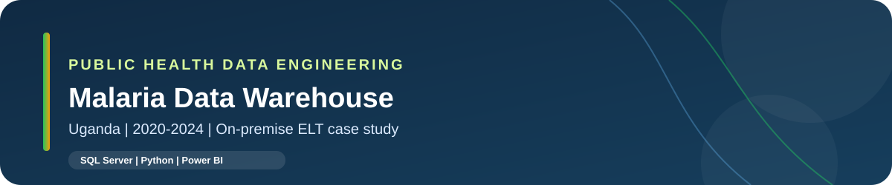
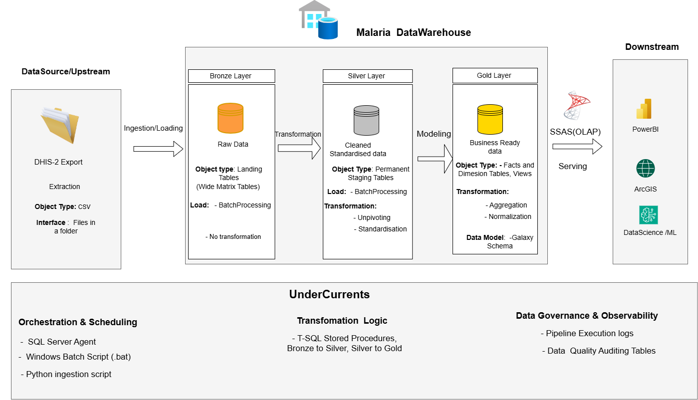
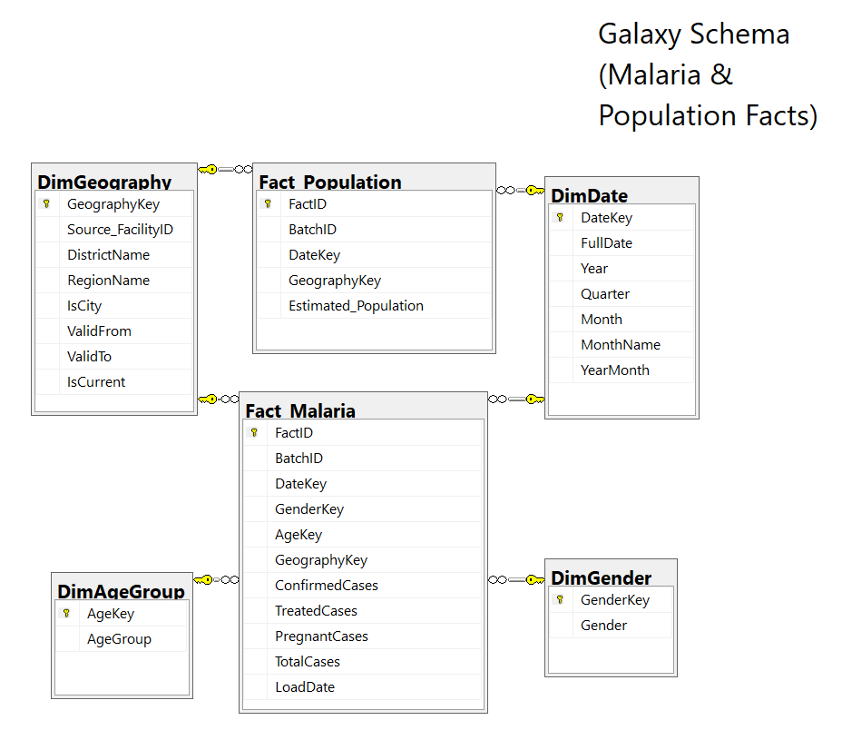

<p align="center">
  
</p>

<p align="center">
  <a href="https://github.com/bashirssimbwa/malaria_DataWareHouse"></a>
  
  
  
  
  
</p>

<p align="center">
  <a href="#architecture"></a>
  <a href="#data-model"></a>
  <a href="#pipeline-reliability"></a>
  <a href="#roadmap"></a>
</p>

# Malaria Data Warehouse | Uganda, 2020-2024

An **on-premise ELT and dimensional-warehouse engineering case study** for preparing monthly DHIS2-exported malaria records from Uganda for downstream public-health analytics. The project combines Python-based file ingestion, SQL Server landing and transformation layers, stored-procedure orchestration, dimensional modelling, data-quality reconciliation, execution logging, email notifications and analytical serving.

> **Scope note:** This is a portfolio/research engineering prototype, not a certified Ministry of Health production system or a clinical decision-support product. Findings are descriptive; observed trends do not establish that a particular intervention caused a change in cases.

## Quick navigation

| Area | Go to |
|---|---|
| Pipeline diagram | [Current architecture](./docs/architecture/pipeline-architecture.svg) |
| Warehouse diagram | [Gold dimensional model](./docs/architecture/warehouse-model.svg) |
| Planning and design | [`Design/`](./Design/) |
| SQL scripts | [`SQL SCRIPTS/`](./SQL%20SCRIPTS/) |
| Warehouse implementation materials | [`malaria_analytics_mds/`](./malaria_analytics_mds/) |
| Notebooks | [`NoteBooks/`](./NoteBooks/) |
| Reports | [`Malaria Report/`](./Malaria%20Report/) |
| Data folders | [`Malaria data/`](./Malaria%20data/), [`Project Data/`](./Project%20Data/), [`JSON files/`](./JSON%20files/) |
| Issues and investigation notes | [`Problems Found/`](./Problems%20Found/) |
| Current repository | [Open on GitHub](https://github.com/bashirssimbwa/malaria_DataWareHouse) |

---

## Contents

- [Project overview](#project-overview)
- [Objectives](#objectives)
- [Architecture](#architecture)
- [Pipeline walkthrough](#pipeline-walkthrough)
- [Data model](#data-model)
- [Pipeline reliability](#pipeline-reliability)
- [Quality checks and observability](#quality-checks-and-observability)
- [Analytics and serving](#analytics-and-serving)
- [Repository guide](#repository-guide)
- [Run and configuration guide](#run-and-configuration-guide)
- [Engineering validation checklist](#engineering-validation-checklist)
- [Roadmap](#roadmap)
- [Limitations and responsible use](#limitations-and-responsible-use)
- [References](#references)

## Project overview

Public-health dashboards are only as trustworthy as the data preparation, transformation and validation behind them. This project explores how to turn wide, matrix-shaped CSV exports into structured analytics tables using an explicit, testable batch pipeline.

The working scope is malaria records covering **2020-2024**, aggregated by reporting period and geographic and demographic attributes. The source files are DHIS2 exports placed in a configured local folder; Python performs ingestion, while SQL Server handles transformation, warehouse loading, audit records and analytical storage.

### Why this project exists

- Convert wide exported reports into a consistent relational structure.
- Keep raw landing data available for investigation and controlled reprocessing.
- separate transformation stages so each operation can be logged, debugged and validated.
- Build a dimensional model suitable for time-series, demographic and regional analysis.
- Test production-oriented design concerns: reruns, transactions, historical dimensions, reconciliation, observability and operational notification.
- Demonstrate a repeatable engineering path using tools that can run locally, while keeping principles transferable to cloud and modern data stacks.

## Objectives

1. **Reliable ingestion:** load source CSV exports and preserve batch-level traceability.
2. **Schema normalization at the data-preparation stage:** unpivot wide metric columns and standardize values into a row-oriented staging structure. This is data-shape standardization; it should not be confused with relational normalization into 3NF.
3. **Dimensional modelling:** expose fact and dimension tables in a Gold/reporting layer.
4. **Historical context:** use SCD Type 2 for applicable mutable geographic attributes, maintaining effective dates and surrogate keys.
5. **Data integrity:** apply transaction handling to coherent database operations and enforce fact-grain uniqueness at the database boundary.
6. **Data quality:** compare source and target measures, log validation outcomes and investigate rejected or anomalous records.
7. **Operational traceability:** record step status, row counts, timestamps, errors and BatchID relationships.
8. **Analytics delivery:** serve data to Power BI and the analytical semantic layer, with gateway-supported refresh where configured.

## Technology stack

| Component | Current role | Status |
|---|---|---|
| DHIS2 CSV exports | Upstream source format | In use |
| Python | File ingestion and orchestration hand-off | In use |
| Windows batch script (`.bat`) | Invokes the Python ingestion process from the job | In use |
| SQL Server / T-SQL | Landing, transformation, dimensions, facts, audit and views | In use |
| SQL Server Agent | Runs ingestion and the T-SQL pipeline steps | In use |
| Database Mail / email | Job and pipeline notifications | Configured for current job; validate warning/failure content |
| Power BI Service + on-premises gateway | Report publication and scheduled access/refresh | Configured for the current environment |
| SQL Server Analysis Services (SSAS) | Analytical model / semantic serving layer | Included in the current architecture; document deployed model mode and refresh path |
| dbt | Test a declarative analytics-testing workflow against a static snapshot | Planned experiment; not a dependency of the current pipeline |
| Apache Airflow | Compare DAG-based orchestration with SQL Server Agent | Planned learning/architecture experiment |
| Snowflake / cloud platform | Potential migration/comparison environment | Not part of the current runtime unless separately demonstrated |

## Architecture

<p align="center">
  <a href="./docs/architecture/pipeline-architecture.png"></a>
</p>

**Current flow:** DHIS2 CSV export -> Python ingestion -> Bronze landing -> T-SQL unpivot/standardization into the current-batch staging workspace -> Gold dimensions and fact tables -> SSAS/Power BI and other analytical consumers.

The control plane cuts across the flow: SQL Server Agent scheduling, stored-procedure execution, transaction handling, audit logging, data-quality checks and email notification.

### Architecture principles

- **Bronze is recoverable landing data.** Retain source/batch context so a transformation can be investigated or rerun.
- **Stage is a work area in the current design.** The latest Bronze-to-stage procedure uses `TRUNCATE` followed by a batch reload. This is not a historical staging ledger; keep history in Bronze or another explicit history store.
- **Gold is durable analytical state.** Fact and dimension tables should have documented grain, keys and correction semantics.
- **BatchID is traceability metadata.** It associates records with a pipeline run; it is not, by itself, a business key or idempotency guarantee.
- **Quality outcomes are data.** Persist quality and reconciliation results rather than relying only on a successful SQL Agent status.
- **Automation and transformation are separate concerns.** SQL Server Agent schedules work; stored procedures execute database logic.

## Pipeline walkthrough

### 1. Source and ingestion

- Source: exported DHIS2 CSV files in a configured folder.
- The Python ingestion component reads input files and loads their raw representation to the Bronze schema.
- A Windows batch wrapper makes the Python command callable from a SQL Server Agent CmdExec job step.
- A BatchID/run identifier and ingestion metadata should travel with every loaded batch.

**Operational rule:** keep source paths, credentials and machine-specific configuration outside committed code where possible. Do not commit restricted source files or secrets to GitHub.

### 2. Bronze: raw landing

Bronze preserves the incoming wide/matrix-shaped source representation. Avoid silently changing the source semantics at this point. Capture enough metadata to identify the source file, ingestion time and batch.

### 3. Bronze to stage: unpivot and standardize

The first T-SQL transformation converts wide monthly/metric columns into a row-oriented structure using dynamic unpivot logic (the implementation has used `CROSS APPLY (VALUES ...)` patterns). The stage table is refreshed for the current batch using `TRUNCATE` and reload.

This makes the next warehouse-loading steps smaller and easier to validate than one monolithic script. Because the stage table is transient, it should not be described as the system of record for historical row versions.

### 4. Stage to Gold: dimension synchronization and fact load

The stored procedures are separated by responsibility:

1. Synchronize dimensions, including effective-dated geography history where appropriate.
2. Resolve surrogate keys for the source rows.
3. Load the malaria fact at its declared grain.
4. Run reconciliation and data-quality checks.
5. Record run outcomes and let the orchestration layer report success/failure.

Exact stored-procedure filenames and execution order should be verified against the scripts in [`SQL SCRIPTS/`](./SQL%20SCRIPTS/) and [`malaria_analytics_mds/`](./malaria_analytics_mds/) before external publication.

### 5. Orchestration and notification

The SQL Server Agent job currently has a Python-ingestion CmdExec step and a T-SQL orchestration step. The job sends email notifications. The production-oriented next step is to make those emails include the BatchID, per-step state, duration, row metrics, failed quality rules and actionable error details - not just the generic job result.

## Data model

<p align="center">
  <a href="./docs/architecture/warehouse-model.png"></a>
</p>

### Core fact and dimensions

| Object | Role | Important design notes |
|---|---|---|
| `gold.Fact_Malaria` | Measures for confirmed cases, treated cases, pregnancy-related cases and total recorded cases | Document the business grain and enforce uniqueness at that grain. `BatchID` supports traceability. |
| `gold.DimDate` | Calendar context | Date, month, quarter, year and year-month attributes support time-series analysis. |
| `gold.DimAgeGroup` | Age-band context | Standardized age-group labels and a surrogate key. |
| `gold.DimGender` | Gender context | Standardized labels and a surrogate key. |
| `gold.DimGeography` | Facility/district/city/region context | Surrogate `GeographyKey`, source FacilityID/business key, and `ValidFrom`, `ValidTo`, `IsCurrent` for SCD Type 2 where applicable. |

### Fact grain: make this explicit before final release

The current source columns suggest an intended grain of **facility x reporting month x age group x gender**, with case measures attached. Treat this as a hypothesis until a source-grain/duplicate analysis confirms it. If the source contains another dimension or reporting discriminator, include it in the grain and in the uniqueness tests.

### SCD Type 2 and effective dating

SCD Type 2 applies to changes in **dimension attributes**, not physical table schema changes. When a tracked geographic attribute changes, the old dimension row is closed and a new surrogate-key version is inserted. Historical facts keep their original `GeographyKey`; newly loaded facts resolve against the correct geography version for the record's effective/reporting date.

A rename and an administrative boundary change are not identical business events. If an identifier changes but the facility remains the same entity, use an explicit crosswalk/business-key policy rather than assuming it is a new facility automatically.

### Planned conformed-dimension expansion

Population estimates, weather and other contextual datasets could be modelled as additional facts sharing dimensions such as Date and Geography, but only after defining each source's own grain and temporal/spatial semantics. This is a future extension, not a claim that a fully integrated multi-fact model is already validated.

## Pipeline reliability

### Transactions and ACID

Use transactions around coherent database units of work. A `TRUNCATE` plus reload can be made atomic inside a transaction so a failed load can roll back instead of leaving a partially refreshed stage table. Dimension Type 2 changes (closing an old row and inserting a new version) should also be atomic. Avoid an unnecessarily broad transaction spanning Python/file I/O and all database stages.

The implementation should use and test a consistent error-handling pattern (for example `SET XACT_ABORT ON`, `TRY/CATCH`, `XACT_STATE()`, `ROLLBACK`, and `THROW`). Audit status updates need deliberate placement so a rollback does not erase the only evidence that a run failed.

### Idempotency

**Idempotency is a property of the result, not a synonym for deleting and reloading data.** The same logical input should not create unintended duplicate facts when replayed. `BatchID` changes between runs are expected in many pipelines, so it must not be the only duplicate-prevention key.

Before claiming idempotency as complete:

1. Define the fact grain and corresponding business/natural key.
2. Add a unique constraint/index over the resolved key columns where appropriate.
3. Make the load handle the same batch replay and a new BatchID containing the same logical records.
4. Decide whether changed source measures mean ignore, update, reverse/correct, or preserve history.
5. Test failed and concurrent runs; keep a database-enforced uniqueness guard even if an anti-join is used.

Do not apply SCD Type 2 mechanically to facts. Fact correction policy is a business requirement of its own.

## Quality checks and observability

### Execution logging

The current `PipelineExecutionLog` captures run/step details such as BatchID, task name, target, status, rows read/written, timestamps and error message. Use it to answer: *what ran, when, against which batch, how long did it take, and what failed?*

### Data-quality and reconciliation logging

`DataQualityCheckLogs` captures a check identifier, BatchID, target, metric name, source and target values, variance, result, action and timestamp. Example: a run reconciliation check compares the total cases in the source/staging set with the expected target total and records the difference.

### Recommended core checks

- Schema/required-column validation before transformation.
- Required business keys and valid dimensional members.
- Allowed domains for Year, Month, AgeGroup and Gender.
- Non-negative measures where permitted by the data contract.
- Duplicate detection at the confirmed fact grain.
- Source-to-stage and stage-to-Gold row/measure reconciliation.
- Foreign-key/orphan checks and dimension lookup failures.
- Monitoring of rows read, inserted, updated, rejected and skipped.
- Zero-row and unusual volume checks against an expected range.
- Runtime history and last-successful-run monitoring.

### Missing facilities are not the same as NULL measures

Preserving NULL measure values is useful, but it does not reveal a facility-period combination that is completely absent from the source. To identify non-reporting facilities, build an expected facility x reporting-period scaffold (from an authoritative facility roster and reporting calendar) and left join the actual report data. Keep distinct statuses for **no report received**, **reported zero**, and **unknown/not supplied**.

### Notifications

Emails should summarize the run rather than dump entire audit tables. A useful failure/warning mail includes pipeline name, BatchID, step, start/end/duration, rows read/written/rejected, failed quality rules, reconciliation variance and the error message. Success emails may be less verbose or configured separately from warnings/failures.

## Analytics and serving

### Power BI

Power BI reports provide descriptive views such as confirmed cases by year/quarter, confirmed versus treated measures, distribution by gender, and regional patterns. The Power BI Service can use an on-premises data gateway to reach an on-prem SQL Server/SSAS source; scheduled refresh behavior depends on the connection mode and gateway configuration. The current deployment details should be documented without publishing machine names or credentials.

### SQL Server Analysis Services (SSAS)

SSAS is the semantic/analytical model layer, not simply another name for the relational warehouse. Document whether the project deploys a **Tabular** or **Multidimensional** model, where measures/relationships are defined, how the model is processed, and how Power BI connects. SSAS models can serve Power BI and Excel; model mode matters for refresh and connection choices.

### Descriptive findings and interpretation

Initial dashboard work reports a peak in confirmed cases in 2022 and a decline in totals through 2024, as well as differences by gender and region. These must be validated against source definitions, deduplication and reconciliation before being published as final statistics. A trend alone cannot establish that prevention or treatment interventions caused the decline.

## Repository guide

The repository currently contains exploration, design and implementation material in several root-level folders. These links reflect the observed repository layout; cleanup and relocation should be incremental so scripts and notebook paths do not silently break.

| Current path | Intended navigation use |
|---|---|
| [`Design/`](./Design/) | Architecture diagrams, modelling and design decisions. |
| [`SQL SCRIPTS/`](./SQL%20SCRIPTS/) | SQL DDL, transformation, loading and validation scripts. Confirm canonical copies before deleting duplicates. |
| [`malaria_analytics_mds/`](./malaria_analytics_mds/) | Data-warehouse implementation materials and related engineering work. |
| [`NoteBooks/`](./NoteBooks/) | Exploratory analysis and notebook-based work. |
| [`Malaria Report/`](./Malaria%20Report/) | Report/export artefacts; check that anything public contains no restricted data. |
| [`Malaria data/`](./Malaria%20data/), [`Project Data/`](./Project%20Data/), [`JSON files/`](./JSON%20files/) | Data and geographic reference material. Review provenance and redistribution rights before committing. |
| [`weather Data/`](./weather%20Data/) | Weather-related source/experiment material; document whether it is part of the operational pipeline or a future extension. |
| [`Problems Found/`](./Problems%20Found/) | Troubleshooting notes and known issues. |
| [`Extra Files/`](./Extra%20Files/) | Temporary/supporting artefacts; consider relocating durable documents to `docs/`. |

### Recommended target structure

This is a **proposed cleanup target**, not a claim that every directory already exists. Move files in stages after identifying the authoritative copy of each script.

```text
malaria_DataWareHouse/
├── README.md
├── docs/
│   ├── architecture/
│   │   ├── pipeline-architecture.svg
│   │   └── warehouse-model.svg
│   ├── screenshots/
│   ├── decisions/                 # ADRs: staging, fact grain, SCD2, idempotency
│   └── research/                  # paper, data dictionary, methodology
├── ingestion/                     # Python CSV ingestion
├── automation/                    # .bat wrapper and deployment notes
├── sql/
│   ├── 00_database_and_schemas/
│   ├── 01_bronze/
│   ├── 02_stage/
│   ├── 03_dimensions/
│   ├── 04_facts/
│   ├── 05_quality_and_audit/
│   ├── 06_views/
│   └── 07_orchestration/
├── analytics/
│   ├── powerbi/
│   └── ssas/
├── validation/                    # reproducible SQL QA scripts
├── dbt_analytics/                 # future/experimental; static snapshot first
├── airflow/                       # future orchestration experiment
├── notebooks/
├── data/
│   ├── sample/                    # tiny synthetic/sanitized examples only
│   └── raw/                       # ignored by Git if restricted/large
└── .gitignore
```

Before committing the final public README, remove `.ipynb_checkpoints/` and rename any ambiguous notebook such as `Untitled.ipynb`. Do not commit secrets, machine-specific connection strings, large source extracts or data whose redistribution rights are unclear.

## Run and configuration guide

This project is tied to a local/on-premise SQL Server environment, so there is not yet a fully portable one-command Docker setup. The following is the operator-oriented sequence; exact script paths and parameter names must match the checked-in implementation.

1. **Clone the repository** and inspect [`malaria_analytics_mds/`](./malaria_analytics_mds/) and [`SQL SCRIPTS/`](./SQL%20SCRIPTS/) to identify the authoritative deployment scripts.
2. **Prepare the environment:** install a compatible Python version and the required packages used by the ingestion script; install/configure SQL Server, SSMS and SQL Server Agent.
3. **Configure the source folder:** place authorized DHIS2 CSV exports in the configured input directory and update local configuration without committing private paths or credentials.
4. **Deploy the database:** create the database and schemas (`bronze`, `stage`, `gold`, `audit`, and `rpt`/reporting if used); deploy tables, constraints, stored procedures and views in dependency order.
5. **Run ingestion manually first:** verify raw row counts, source file identity and BatchID before enabling automation.
6. **Configure SQL Server Agent:** set the CmdExec step for the `.bat`/Python ingestion and the T-SQL step for the master orchestrator. Configure a SQL Agent proxy/permissions appropriately rather than granting broad privileges to make CmdExec work.
7. **Configure Database Mail/notifications:** test delivery and confirm failures produce a failed job/run record with useful error details.
8. **Validate the run:** inspect `PipelineExecutionLog`, `DataQualityCheckLogs`, row reconciliation, duplicate checks and target fact counts.
9. **Connect analytical consumers:** configure SSAS/Power BI sources and the on-premises gateway with matching server/database identifiers; test refresh and credentials.

> Detailed commands are intentionally not fabricated here because paths, package versions, credentials, SQL Server instance name and stored-procedure parameters are environment-specific. Add a tested `requirements.txt`, sanitized example configuration and exact deployment scripts to make this guide fully reproducible.

## Engineering validation checklist

Use this checklist as a release gate. Only change a box to `[x]` when there is a saved test script or run evidence.

- [ ] A batch can be ingested twice without corrupting Bronze lineage or creating ambiguous batch records.
- [ ] `TRUNCATE + reload` in the stage work table is atomic and rolls back cleanly on an injected failure.
- [ ] The declared `Fact_Malaria` grain is documented and validated against source data.
- [ ] A database uniqueness guard prevents duplicate fact-grain combinations.
- [ ] A new BatchID with logically identical source rows does not create duplicate facts.
- [ ] Corrected source measures follow a documented update/correction policy.
- [ ] SCD Type 2 tests prove old versions close, new versions open, and historical facts keep their original dimension key.
- [ ] Fact-date lookups resolve the correct effective-dated geography row.
- [ ] Data-quality rules and source/target reconciliation fail the pipeline when configured as blocking.
- [ ] Failed database operations roll back as intended while the failure audit remains available.
- [ ] Notification emails identify the failing step, BatchID and actionable error.
- [ ] Backup, integrity-check and index-maintenance responsibilities are documented separately from ETL logic.
- [ ] Power BI/SSAS refresh and gateway behavior has been tested after a scheduled load.
- [ ] Public repository contains no credentials, restricted exports or machine-specific secrets.

## Roadmap

| Priority | Work item | Why it matters | Status |
|---|---|---|---|
| P0 | Confirm and enforce fact grain/business key | The foundation of safe idempotent loads | Under validation |
| P0 | Test transaction rollback and audit preservation | Demonstrates safe failure behavior | Under validation |
| P0 | Test SCD2 edge cases and effective-date joins | Protects historical interpretation | Implemented design; broaden tests |
| P1 | Add reproducible SQL QA scripts for reruns, duplicates and reconciliation | Turns design intent into evidence | In progress |
| P1 | Make email summaries severity-aware | Reduces time to diagnose a failed/warning run | Enhancement |
| P1 | Document SSAS model mode and refresh process | Clarifies semantic/OLAP serving | Documentation needed |
| P2 | Run dbt on a static/sanitized snapshot | Learn analytics engineering and declarative tests without changing production flow | Planned experiment |
| P2 | Prototype equivalent orchestration in Airflow | Compare dependency management, retries and scheduling with SQL Server Agent | Planned experiment |
| P2 | Benchmark representative queries and indexing changes | Show measured rather than assumed performance improvement | Planned |
| P3 | Integrate population/weather facts | Expand analytics after source/grain/governance are defined | Future extension |

### Why evaluate dbt and Airflow?

They are planned learning extensions, not technologies required by the current pipeline. First keep a static snapshot and write dbt tests/models against it; then compare the result to the existing T-SQL transformations. Separately prototype the dependency graph and retry semantics in Airflow without running two orchestrators against the same production tables. Keep the SQL Server Agent version as the baseline until the comparison is documented.

## Limitations and responsible use

- The project processes exported/aggregated reports; it does not replace the authoritative DHIS2/MOH source system.
- Data completeness, reporting practice, case definitions and administrative boundary changes can affect interpretations.
- A missing source row is not proof of zero cases. Distinguish no-report, reported zero and missing/unknown values.
- A descriptive fall in reported cases does not establish causation or programme impact.
- Repository data may be subject to source-system permissions or terms. Confirm redistribution rights before publishing raw exports.
- This repository does not include a production SLA, formal disaster-recovery plan, independent security review or a guarantee of national-scale performance.

## References

- [Project repository](https://github.com/bashirssimbwa/malaria_DataWareHouse)
- [SQL Server Agent and job notifications](https://learn.microsoft.com/en-us/ssms/agent/notify-an-operator-of-job-status)
- [SQL Server transaction control](https://learn.microsoft.com/en-us/sql/t-sql/language-elements/transactions-transact-sql)
- [SQL Server `TRUNCATE TABLE`](https://learn.microsoft.com/en-us/sql/t-sql/statements/truncate-table-transact-sql)
- [SQL Server Analysis Services overview](https://learn.microsoft.com/en-us/analysis-services/ssas-overview)
- [Power BI: manage on-premises gateway and SSAS sources](https://learn.microsoft.com/en-us/power-bi/connect-data/service-gateway-enterprise-manage-ssas)
- [Power BI: refresh data from an on-premises SQL Server](https://learn.microsoft.com/en-us/power-bi/connect-data/service-gateway-sql-tutorial)
- [dbt documentation](https://docs.getdbt.com/)
- [Apache Airflow documentation](https://airflow.apache.org/docs/)
- [Snowflake trial-account documentation](https://docs.snowflake.com/en/user-guide/admin-trial-account)

## Acknowledgement

This project is developed as a practical learning and research artefact. Design decisions are being refined through implementation tests, documentation review and practitioner feedback. Feedback should be interpreted as design input, not formal certification of production readiness.
